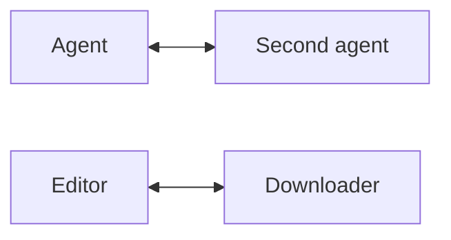

# msp-site

The MSP website.

- **`landing/`** — hand-written static pages: `/` (English) and `/zh/` (Chinese), no build step.
- **`docs-site/`** — the documentation site, built with **Docusaurus 3**. Five independent docs
  instances behind one navbar: Documentation, Specification, Implementations, Design, Case studies.

Live: <https://modelsensingprotocol.github.io/msp-site/>

```
/                          landing/                    hand-written landing page
/zh/                       landing/zh/                 same page, Chinese
/docs/                     docs-site/                  docs, showing 2026-10-10 by default
/docs/next/                                            unreleased work
/docs/spec/                                            specification
/docs/impl/  /docs/design/  /docs/case/                 implementations, design, case studies
/docs/zh/                                              all of the above in Chinese
```

## Quick start

```bash
cd docs-site
npm install
npm run start      # http://localhost:3000/msp-site/docs/
```

The landing page is plain files and needs no toolchain:

```bash
python -m http.server 8899
# http://127.0.0.1:8899/landing/
```

Build:

```bash
cd docs-site && npm run build     # output: docs-site/build
```

## What lives where

| Path | What it is |
|---|---|
| `docs-site/docs/` | Documentation — the working guide (English, source of truth) |
| `docs-site/spec/` | Specification chapters |
| `docs-site/impl/` | Implementation status |
| `docs-site/design/` | Design decisions |
| `docs-site/case/` | Case studies of real adopters |
| `docs-site/i18n/zh/docusaurus-plugin-content-docs-*/` | Chinese translations, one tree per instance |
| `docs-site/versioned_docs/version-2026-10-10/` | Frozen snapshot served at `/docs/` |
| `landing/`, `landing/zh/` | The landing page, both languages |
| `tools/` | `make_favicon.py`, `localize_landing.py` |
| `docs-site/tools/check_examples.py` | Runs the example nodes for real |

Content is copied from the main repository (`docs/wiki/`, `docs/spec/`, `docs/DESIGN.md`). The main
repository stays the source of truth; this one is the published form.

## Everyday tasks

**Add a page.** Drop a `.md` into the right instance and add it to that instance's
`sidebars-*.js`. Nothing else — the navbar tabs are already wired.

**Add a case study.** Put a page in `docs-site/case/`, add it to `sidebars-case.js`, and keep to
what is checkable: the node id, the tools and their arguments, how it is enabled, whether it is on
by default, and what it does *not* do.

**Translate a page.** Copy it to
`docs-site/i18n/zh/docusaurus-plugin-content-docs-<instance>/current/<same-path>.md` and translate.
Missing translations fall back to English.

**Change an example.** Edit `docs-site/static/examples/*.py`, then run the checks below. The pages
in `docs/examples/` embed the same code, so keep them in step.

## Checks

```bash
# the docs build, with broken-link warnings surfaced
cd docs-site && npm run build

# the example nodes actually run: tool call, signal handoff, observer
cd docs-site && PYTHONPATH=../src python tools/check_examples.py
```

The second one is not decoration. It starts `weather.py`, calls `get_weather` and asserts the
result; starts `downloader.py` + `editor.py` and asserts the subscriber really received the
completion signal; and checks that the observer can see a peer.

## Versioning

`/docs/` serves the **2026-10-10** snapshot; unreleased work lives in `docs/` and is served at
`/docs/next/`. To freeze the current state as a new revision:

```bash
cd docs-site
# 1. temporarily drop lastVersion/versions from docusaurus.config.js
# 2. snapshot:
npm run version 2027-01-01
# 3. restore those settings, pointing at the new revision
```

Step 1 matters: `docs:version` fails when the config names a version that does not exist yet.

Only the Documentation instance is versioned — `docs:version` applies to the default instance. The
specification carries its own revision elsewhere (`schema/<revision>/` in the main repository).

## Languages

English is the default locale; Chinese is served from `/docs/zh/` and provided per docs instance
through `i18n/zh/`. Navbar labels are translated in
`i18n/zh/docusaurus-theme-classic/navbar.json` — the key is `item.label.<exact English label>`, and
a mismatch fails silently, so verify the tab actually changes.

## Landing page

Two hand-written pages. `landing/zh/index.html` is generated from the English one:

```bash
python tools/localize_landing.py
```

Run it after editing the English page, or the two drift apart.

## Architecture diagram

The diagram on the docs home and on *Core concepts* is a **Mermaid** flowchart written inline in
the Markdown — not an image. Edit the ```` ```mermaid ```` block in
`docs-site/docs/architecture.md` (and its siblings: the versioned copy, plus the two Chinese
translations) to change it.



It is deliberately a **mesh, not a hub**: AI calls AI, tools call tools, a device calls an agent,
and two dotted green edges carry signals. Node classes give the four kinds their colours — AI
applications, tools, a device, and an observer that only emits signals.

Mermaid needs `@docusaurus/theme-mermaid` plus the optional `@mermaid-js/layout-elk`; both are in
`package.json`. Rendering happens client-side, so the diagram needs JavaScript — the surrounding
prose does not.

## Favicon

```bash
pip install pillow
python tools/make_favicon.py
```

Generates `favicon-{16,32,48,64,180,512}.png` and `favicon.ico` into `docs-site/static/` and
`landing/assets/`. The mark is a square with no rounded corners: a centre node, three satellites,
and one **direct link** between two satellites — the node-to-node path that does not go through the
centre.

## Deploy

`.github/workflows/pages.yml`: `npm ci`, then `npm run build`, then assemble `landing/` at the site
root and `docs-site/build/` under `/docs/`, and upload that. Needs **Settings → Pages → Source:
GitHub Actions** once.

## Costs, stated plainly

- A second toolchain lives in this repository: `node_modules` is about 218 MB and a cold build takes
  roughly 30–60 s, where MkDocs rendered 48 pages in 2–8 s.
- `docs:version` only versions the default instance, so Specification, Implementations, Design and
  Case studies are unversioned by design.
- The landing page is duplicated by design; the generator keeps the two copies in step.

Those costs are accepted because versioned docs and a language switcher were two plugins plus two
workarounds under MkDocs Material, and both are native here.

## Don't let the diagram lie

The landing page draws four kinds of edges — observed, reported by a peer, inferred, and known but
not connected — because MSP has no gossip: a node only ever sees its own edges. Collapsing them into
one line would be the easiest lie this site could tell.

## License

MIT — see [LICENSE](LICENSE).
