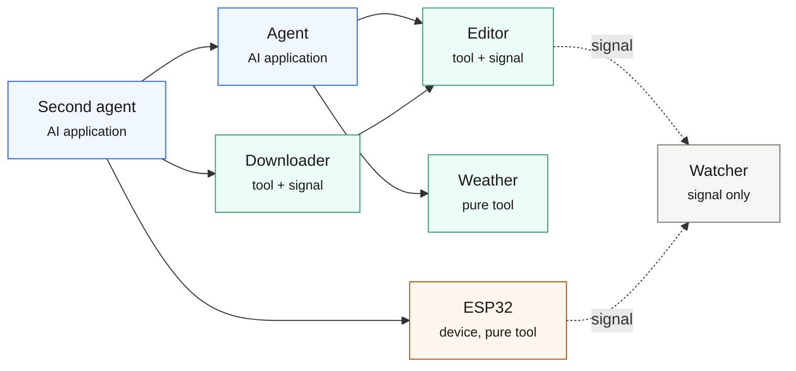

# Core Concepts



*An arrow means a call: the tail is the caller, the head is the node being called. So an agent calls
an editor, a pure tool or a device; one agent calls another; and a downloader hands a finished file
straight to an editor. Dotted green arrows are signals — the editor and the ESP32 broadcast, the
observer only listens. Nothing goes through a model, and there is no hub.*


## Node

A participant inside a process. You give it an id at construction time; that is its name on the network:

```python
node = MSPNode("weather", preset=Preset.LOCAL_TOOL)
```

The id **MUST** match `^[a-z0-9_-]+$` — **lowercase letters, digits, underscores, hyphens**, with no dots and no uppercase.

**The id affects the direction of the connection.** When two nodes discover each other they dial at the same time; MSP picks one direction by lexicographic order and closes the other:
the side with the smaller `node_id` is responsible for outbound. This is not a security mechanism, only a deduplication rule; it still matters when naming a cloud node
(the node that sorts first becomes the one dialling out).

## Preset

A preset decides which capabilities the node has, so you do not install them one by one:

| preset | Purpose |
|---|---|
| `Preset.LOCAL_TOOL` | Local tool provider: announces tools, is discoverable |
| `Preset.FULL_PEER` | Full peer node: can both be called and call others, and can subscribe to broadcasts |
| `Preset.LOCAL_AI` | AI application side: connects to local tools, lazy connection by default |
| `Preset.CLOUD_SERVICE` | Cloud service node |
| `Preset.OBSERVER` | Only observes, offers no capabilities |
| `Preset.MANUAL_PEER` | Only manually specified peers, no automatic discovery |

## Tool

**Request/reply.** The caller initiates, gets a result, and there is a timeout:

```python
@node.tool("get_weather", "Look up the weather")
def get_weather(location: str, days: int = 3) -> dict:
    ...
```

- The return value is wrapped in a `ToolResult`; the caller reads it with `result.structured` or `result.unwrap()`
- An error **does not raise an exception**: `result.is_error` is true, and `result.error` holds the reason
- `input_schema` is generated from the type annotations by default; it is only used for announcement and **does not take part in runtime validation**

## Signal

**Broadcast.** Once it is sent you are done; the sender guarantees neither whether it arrives nor how many copies do:

```python
node.declare_signal("weather.updated", description="Weather data updated")
node.publish("weather.updated", {"location": "Hangzhou", "temp_c": 21})
```

The other side receives it like this:

```python
@node.on("weather.*")            # supports * and ** wildcards
def handle(sig):
    print(sig.path, sig.payload)
```

**Signals are not retained**: anything sent while disconnected is lost for good, and a reconnect does not replay it. For the "current value" you **MUST** fetch a snapshot yourself
(query it with a tool); treat a signal as a change notification rather than as state.

## Leases and discovery

**Directory announcement + lease**: a node writes a declaration to `~/.msp/nodes/<node_id>.json`, containing the endpoint
(host/port) and a `timestamp`; while running it rewrites the `timestamp` every **10 seconds**.

`now - timestamp > 30 seconds` means expired, equivalent to "the node is dead" — so **the upper bound for a crashed node to disappear is 60 seconds**
(30 seconds to expire plus at worst one 30-second polling cycle).

Discovery stands on two legs: an **event channel** (filesystem watching, real time) and a **polling fallback** (a full scan every 30 seconds).

**Discovery and announcement are two orthogonal layers**: scan but do not write = watch but stay silent; write but do not scan = only announce.
Change the directory by passing `nodes_dir=`; different directories cannot see each other.

## Connection

An established long-lived TCP connection. During the handshake the two sides exchange the `manifest` (tools, signals, capabilities), after which:

- Heartbeat: PING every 15 seconds; no response for 45 seconds is judged liveness loss
- When the link drops, every pending call fails immediately instead of waiting out its timeout
- A node can hold connections to several neighbours at once

## Wire format

JSON with eight constant top-level fields, prefixed with a 4-byte big-endian length:

```json
{"type":"tool_call","source":"agent","pattern":null,"target":"weather",
 "path":null,"reqid":"r1","payload":{"tool":"get_weather","args":{...}},"timestamp":1761000000.0}
```

Unknown top-level fields are conservatively kept in `extras` and echoed back unchanged — this leaves room for the protocol to evolve.
