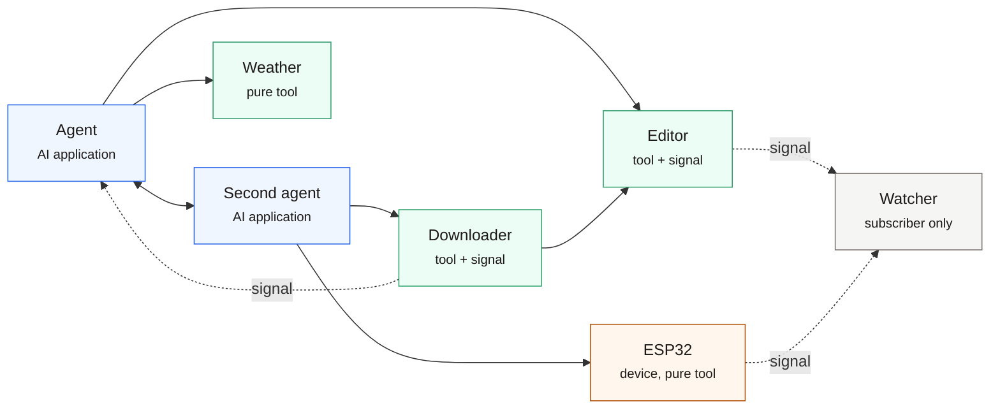

# MSP documentation

*A solid arrow is a call: the tail is the caller. Two agents call each other in both directions; an
agent calls an editor, a pure tool or a device; a downloader hands a finished file straight to an
editor. Dotted green arrows are signals — the downloader pushes progress to an agent, while the
editor and the ESP32 broadcast and a subscriber-only node listens. Nothing goes through a model, and
there is no hub.*

Model Sensing Protocol lets processes on a machine — or across a LAN — discover each other, call
each other's tools, and broadcast events. A node announces itself with a **lease**, so "what is
running right now" is something you read rather than something you configure.

This is the working guide. The normative text lives in the specification; the reasoning behind the
design lives in the positioning document.

## Start here

| Page | What it answers |
|---|---|
| [Introduction](intro.md) | install, run two nodes, call across them — five minutes |
| [Architecture & concepts](architecture.md) | node, preset, tool, signal, lease, connection |
| [Why MSP, not MCP](why-not-mcp.md) | what the two protocols actually differ on, including costs |
| [Provide tools and signals](provide-tools.md) | expose capabilities, publish events, task patterns |
| [Discover, call, subscribe](consume.md) | discovery vs connection, error semantics, subscriptions |
| [FAQ & troubleshooting](faq.md) | symptom → cause table, and how to narrow it down |
| [Glossary](glossary.md) | terms, one line each, with where they live in the source |

## Two things worth knowing before you write code

**Signals are fire-and-forget.** Nothing is retained; a subscriber that was offline missed it. Treat
a signal as *"something changed"* and fetch the state with a tool.

**MSP has no gossip.** A node sees only its own edges; there is no "who are your neighbours" query
in the protocol. Any topology view above `observed` is either self-reported by a peer or inferred —
and should be labelled as such.
