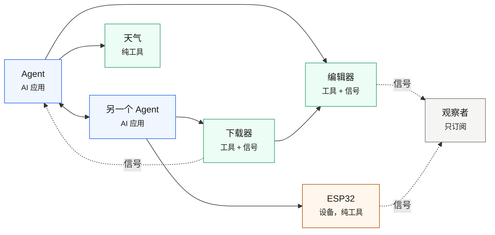

# 核心概念



*实线是调用，尾巴是调用方。两个 agent 之间可以互相调用（双向）；agent 会调编辑器、纯工具或设备；
下载器把完成的文件直接交给编辑器。绿色虚线是信号——下载器把进度推给 agent，编辑器与 ESP32 广播，
只订阅的节点负责听。没有哪条消息经过模型，也没有中心。*


## 节点（node）

一个进程里的参与者。构造时给一个 id，就是它在网络里的名字：

```python
node = MSPNode("weather", preset=Preset.LOCAL_TOOL)
```

id 必须匹配 `^[a-z0-9_-]+$`——**小写、数字、下划线、连字符**，没有点、没有大写。

**id 会影响连接方向。** 两个节点互相发现时会同时拨号，MSP 按字典序挑一个方向、关掉另一条：
`node_id` 更小的那方负责出站。这不是安全机制，只是去重规则；但给云节点起名时要注意
（字典序在前的节点会成为主动出站方）。

## 预置（preset）

预设决定这个节点具备哪些能力，不用逐个装：

| preset | 用途 |
|---|---|
| `Preset.LOCAL_TOOL` | 本机工具提供者：宣告工具、可被发现 |
| `Preset.FULL_PEER` | 完整对等节点：既能被调也能调别人、能订阅广播 |
| `Preset.LOCAL_AI` | AI 应用侧：连本机工具、默认懒连接 |
| `Preset.CLOUD_SERVICE` | 云端服务节点 |
| `Preset.OBSERVER` | 只观察不提供能力 |
| `Preset.MANUAL_PEER` | 只有手动指定的对端，不自动发现 |

## 工具（tool）

**请求-应答**。调用方发起、拿结果、有超时：

```python
@node.tool("get_weather", "查询城市天气")
def get_weather(location: str, days: int = 3) -> dict:
    ...
```

- 返回值会被包成 `ToolResult`，调用方用 `result.structured` 或 `result.unwrap()` 取
- 出错**不抛异常**：`result.is_error` 为真，`result.error` 里是原因
- `input_schema` 默认从类型注解生成，仅用于对外宣告，**不参与运行时校验**

## 信号（signal）

**广播**。发出去就不管了，收不收、收几条都不由发送方保证：

```python
node.declare_signal("weather.updated", description="天气数据更新")
node.publish("weather.updated", {"location": "杭州", "temp_c": 21})
```

对面这样收：

```python
@node.on("weather.*")            # 支持 * 与 ** 通配
def handle(sig):
    print(sig.path, sig.payload)
```

**信号没有留存**：没连上时发的就永远丢了，重连也不会补发。要"当前值"必须自己拉一次快照
（用工具查），把信号当成"变化通知"而不是状态。

## 租约（lease）与发现

**目录宣告 + 租约**：节点往 `~/.msp/nodes/<node_id>.json` 写一份声明，内容是端点
（host/port）与 `timestamp`；运行期间每 **10 秒**重写一次 `timestamp`。

`now - timestamp > 30 秒` 即过期，等同"节点已死"——所以**崩溃节点的消失上界是 60 秒**
（30 秒过期 + 最坏一个 30 秒轮询周期）。

发现由两条腿组成：**事件通道**（文件系统监听，实时）与**轮询兜底**（30 秒一次全量扫描）。

**发现与宣告是两个正交的层**：只扫不写 = 只看不说；只写不扫 = 只说。
换目录传 `nodes_dir=`，不同目录互相看不见。

## 连接（connection）

一条已建立的 TCP 长连接。握手时双方交换 `manifest`（工具、信号、能力），之后：

- 心跳：15 秒 PING，45 秒无响应判失联
- 断线时所有挂起的调用立刻失败返回，不会白等到超时
- 一个节点可以与多个邻居同时保持连接

## 线格式（wire）

8 个顶层字段恒定的 JSON，前面加 4 字节大端长度前缀：

```json
{"type":"tool_call","source":"agent","pattern":null,"target":"weather",
 "path":null,"reqid":"r1","payload":{"tool":"get_weather","args":{...}},"timestamp":1761000000.0}
```

未知的顶层字段会被保守地保留在 `extras` 里并原样回显——这是给协议演进留的余地。
