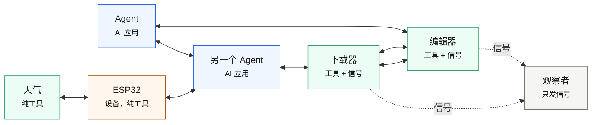

# MSP 文档

*实线是调用（任意节点都能调任意节点），绿色虚线是信号。AI 连 AI、工具连工具、设备调 agent——
没有哪条消息必须经过模型，也没有必须经过的中心。*

Model Sensing Protocol 让同一台机器——或同一个局域网——上的进程互相发现、互相调用工具、
互相广播事件。节点用**租约**宣告自己的存在，所以"现在有什么在跑"是随时可读的事实，
而不是需要维护的配置。

这里是使用指南。规范正文在 spec 里，设计取舍在定位文档里。

## 从哪读起

| 页面 | 回答什么 |
|---|---|
| [快速开始](intro.md) | 装包、起两个节点、跨节点调用——五分钟 |
| [架构与概念](architecture.md) | 节点、预置、工具、信号、租约、连接 |
| [与 MCP 的区别](why-not-mcp.md) | 两个协议真正的分歧在哪，包括代价 |
| [提供能力](provide-tools.md) | 暴露工具、发布信号、任务模式 |
| [发现、调用与订阅](consume.md) | 发现 vs 连接、错误语义、订阅通配 |
| [FAQ 与排查](faq.md) | 症状 → 原因对照表，怎么一步步收窄 |
| [术语表](glossary.md) | 术语，一句话一个，附源码位置 |

## 写代码前该知道的两件事

**信号是发完即忘的。** 没有任何留存；订阅者离线期间发的那条就永远丢了。把信号当成
*"有东西变了"*，状态用工具回查。

**MSP 没有 gossip。** 一个节点只看得见自己的边，协议里没有"你的邻居是谁"这种查询。
任何超过 `observed` 级别的拓扑视图，都是对端自报或推断——必须标明是哪种。
